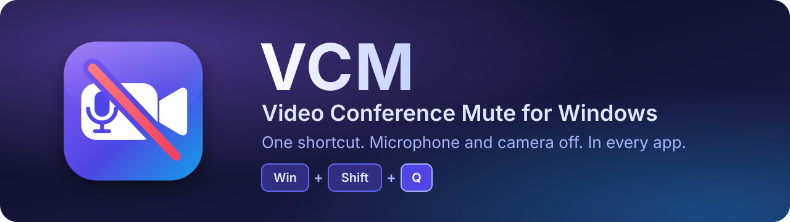

<p align="center">
  
</p>

<p align="center">
  <a href="https://github.com/SimoneFaricelli/video-conference-mute/releases/latest"></a>
  <a href="https://github.com/SimoneFaricelli/video-conference-mute/releases"></a>
  
  
  <a href="LICENSE"></a>
</p>

<p align="center">
  <b>The PowerToys Video Conference Mute utility, back as a standalone app.</b><br>
  It was removed from PowerToys after v0.87.1. VCM brings it back with every original feature and a modern,
  lightweight core.
</p>

<p align="center">
  <a href="https://github.com/SimoneFaricelli/video-conference-mute/releases/latest"><b>⬇️ Download the installer</b></a>
  &nbsp;·&nbsp;
  <a href="#-getting-started">🚀 Getting started</a>
  &nbsp;·&nbsp;
  <a href="#%EF%B8%8F-build-from-source">🛠️ Build</a>
</p>

---

## 💡 What it does

Press **one shortcut** and your microphone and camera go silent, **system-wide**. It works in Teams, Zoom, Meet,
Discord, the browser, or any other app, whichever window has focus. A small toolbar shows the state at a glance, and
the camera keeps streaming an image of your choice so the call never sees a frozen frame.

## ⌨️ Default shortcuts

| | Action | Shortcut |
|:-:|---|---|
| 🔇 | Mute camera & microphone | <kbd>Win</kbd> + <kbd>Shift</kbd> + <kbd>Q</kbd> |
| 🎙️ | Mute microphone | <kbd>Win</kbd> + <kbd>Shift</kbd> + <kbd>A</kbd> |
| 🗣️ | Push to talk (hold) | <kbd>Win</kbd> + <kbd>Shift</kbd> + <kbd>I</kbd> |
| 📷 | Mute camera | <kbd>Win</kbd> + <kbd>Shift</kbd> + <kbd>O</kbd> |

All shortcuts can be changed. If Windows or another app already uses a combination, VCM takes it over, just like
PowerToys did.

## ✨ Features

All the features of the original module, with the same settings and the same `settings.json` format. On first run,
your existing PowerToys settings are imported automatically.

- 🎙️ **Microphone**
  - Mute every microphone (`[All]`) or a specific one.
  - **Push to reverse**: hold the shortcut to temporarily mute an open microphone.
- 📷 **Camera**
  - The **"VideoConference Mute"** virtual camera wraps your physical webcam.
  - While muted, it shows an image of your choice (or black).
- 🪟 **Toolbar**
  - Six positions, on the main monitor or on all monitors.
  - Hide it never, when both are unmuted, when both are muted, or after a timeout.
  - Click either half to toggle that device.
- 🔁 **Smart toggling**
  - "Mute camera & microphone" acts on the microphone alone while the camera is idle.
  - If only one of the two is muted, it mutes the other.
- 🚦 **Startup action**: do nothing, unmute or mute.
- 🧹 **Safe exit**: disabling or closing VCM unmutes everything, and so does the last app releasing the camera.

## 🆕 What's better than the original

| | Improvement |
|:-:|---|
| 🎥 | **Media Foundation virtual camera** instead of a DirectShow filter. It also works in the Camera app, the new Teams and browsers. |
| 💡 | **The webcam can really turn off while muted**, light included. This is optional; you can keep the original behaviour. |
| 🔄 | **Live changes**: switching the physical camera or the overlay image applies while streaming. The call app does not need a restart. |
| ⌨️ | **More reliable shortcuts**: they work over elevated windows, are never dropped by Windows, and combinations already used by other apps are taken over. |
| 🖼️ | **Vector toolbar**: sharp at any DPI, localized, and hidden from screen sharing and recordings. |
| 🔔 | **Tray icon**: shows the microphone and camera state. A click toggles the microphone; the menu has the toggles, pause, run at startup and exit. |
| 🔊 | **Optional confirmation sound** when muting and unmuting. |
| 🔒 | **Keep microphone muted**: if another app unmutes it, VCM mutes it again (optional). |
| 🌍 | **Italian and English** interface, picked from the Windows language. |

<details>
<summary>🐞 <b>Bugs of the original that are fixed</b></summary>

- Shortcuts using <kbd>Alt</kbd> did not work.
- Releasing push to talk muted a microphone that was already open.
- Disabling VCM left microphones muted.
- Removed or reconnected microphones were not handled.

</details>

## 🚀 Getting started

1. **Download** `VCM-Setup-x.y.z.exe` from the [latest release](https://github.com/SimoneFaricelli/video-conference-mute/releases/latest)
   and run it.
   - If the .NET 10 Desktop Runtime is missing, the installer downloads it.
   - Administrator rights are needed **once**, to register the virtual camera. VCM itself then runs as a normal
     user from the tray.
2. **Pick the camera**: in your video-call app, select **VideoConference Mute** as the camera.
3. **Done**: press <kbd>Win</kbd> + <kbd>Shift</kbd> + <kbd>Q</kbd> and you are muted. Open the settings from the
   tray icon.

### 📋 Requirements

| | |
|---|---|
| 🪟 Microphone features | Windows 10 2004 or later |
| 🎥 Virtual camera | **Windows 11** (build 22000+) |
| ⚙️ Runtime | .NET 10 Desktop Runtime (installed automatically) |

> [!NOTE]
> The installer is **not code-signed**:
> - SmartScreen shows a warning; choose *More info* → *Run anyway*.
> - With **Smart App Control** enabled, Windows blocks unsigned apps.

## 🛠️ Build from source

Everything builds on **Linux with Docker**, with no Windows machine needed:

```bash
./build/build.sh
```

The script builds the virtual camera DLL, runs the unit tests, publishes the app and packages the installer
`out/VCM-Setup-x.y.z.exe`.

| Component | Toolchain |
|---|---|
| `src/Vcm.VirtualCamera` (C++20 media source DLL) | MSVC + Windows SDK under wine, from [msvc-wine](https://github.com/mstorsjo/msvc-wine) (`build/Dockerfile.msvc`) |
| `src/Vcm.Core`, `src/Vcm.App`, tests | `mcr.microsoft.com/dotnet/sdk:10.0` |
| `installer/vcm.iss` | Inno Setup under wine (`amake/innosetup`) |

> [!IMPORTANT]
> The MSVC image is built on the first run:
> - it takes about 15–30 minutes and about 4 GB;
> - it downloads Visual Studio Build Tools and the Windows SDK, accepting the
>   [Microsoft license](https://go.microsoft.com/fwlink/?LinkId=2086102);
> - that image must not be redistributed.

On Windows you can also build the C# projects with `dotnet build` and the DLL with CMake + Visual Studio 2022.

<details>
<summary>🗂️ <b>Project layout</b></summary>

| Path | Content |
|---|---|
| `src/Vcm.Core` | Platform-independent logic: settings (PowerToys format), mute engine, toolbar rules, pipe protocol |
| `src/Vcm.App` | WPF + WPF-UI app: tray, shortcuts, Core Audio microphones, toolbar, settings window, virtual camera control |
| `src/Vcm.VirtualCamera` | Media source loaded by the Windows Frame Server; named pipe client to the app |
| `tests/Vcm.Core.Tests` | xUnit tests (they run on Linux) |
| `installer/` | Inno Setup script |
| `docs/TESTING.md` | Manual test checklist for Windows |

</details>

## 🩺 Troubleshooting

| What | Where |
|---|---|
| 📄 App log | `%TEMP%\VCM.log` |
| 🎥 Virtual camera log | `%ProgramData%\VCM\camera.log` |
| ⚙️ Settings | `%LOCALAPPDATA%\VCM\settings.json` |

Found a bug? [Open an issue](https://github.com/SimoneFaricelli/video-conference-mute/issues) and attach both logs.

## 📄 License

[MIT](LICENSE). VCM builds on the work of:
- PowerToys;
- the Windows-Camera VirtualCamera sample;
- WPF-UI;
- WIL.

See [THIRD-PARTY-NOTICES.md](THIRD-PARTY-NOTICES.md) for their licenses.

<p align="center"><sub>Made with ☕ for everyone who misses VCM in PowerToys.</sub></p>
